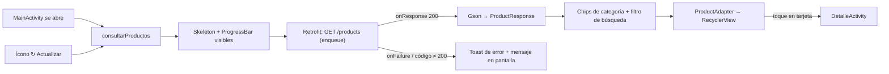
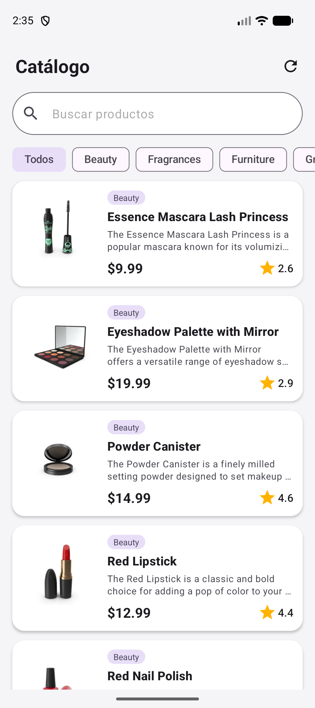
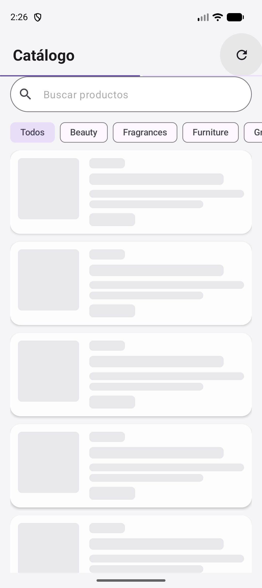
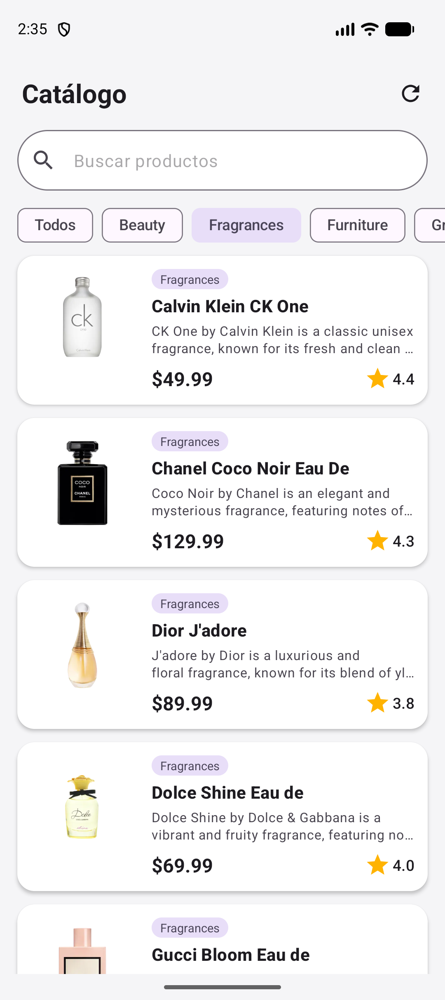
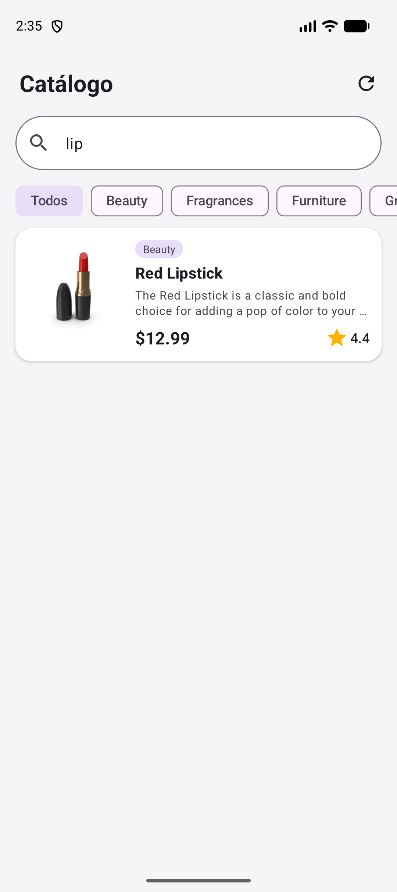
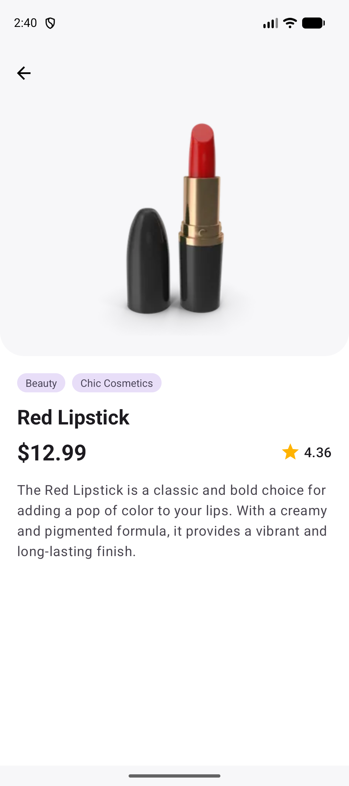
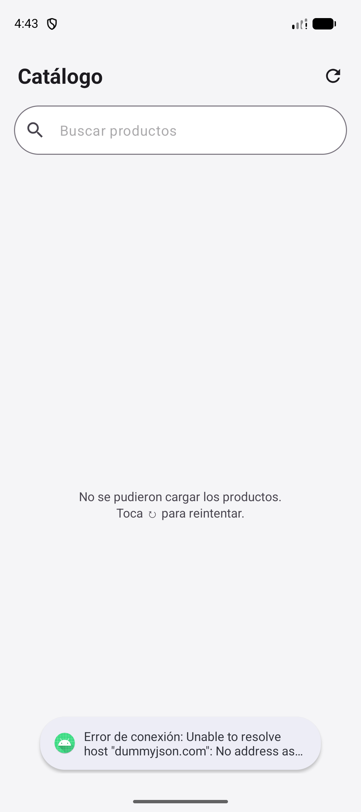
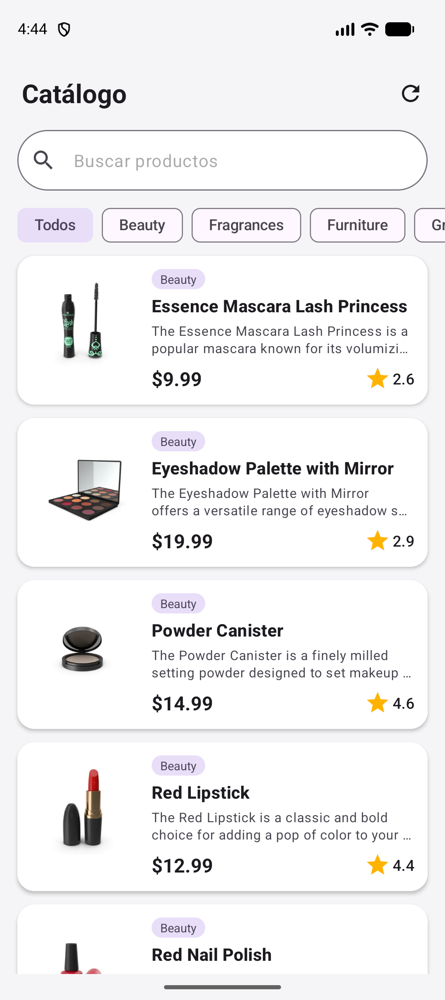

# Examen 03 — Aplicación móvil con Retrofit

Aplicación Android (Java) que consulta el catálogo de productos de la API REST
[DummyJSON – Products](https://dummyjson.com/products) usando **Retrofit**, muestra los
resultados en un `RecyclerView` y permite ver el detalle de cada producto.

| | |
|---|---|
| **Lenguaje** | Java 11 · Layouts XML |
| **SDK** | minSdk 26 · targetSdk 37 |
| **Librerías** | Retrofit 2.11 + Gson · Glide 4.16 · RecyclerView · Material Components |
| **Endpoint** | `GET https://dummyjson.com/products` |

---

## Índice

1. [Flujo general](#flujo-general)
2. [Funcionamiento por criterio de evaluación](#funcionamiento-por-criterio-de-evaluación)
3. [Estructura del proyecto](#estructura-del-proyecto)
4. [Evidencias](#evidencias)
5. [Video demostrativo](#video-demostrativo)
6. [Cómo ejecutar](#cómo-ejecutar)

---

## Flujo general



---

## Funcionamiento por criterio de evaluación

### 1. Configuración de Retrofit (15 pts)

- Dependencias declaradas en [`gradle/libs.versions.toml`](gradle/libs.versions.toml) y
  [`app/build.gradle.kts`](app/build.gradle.kts): `retrofit`, `converter-gson`.
- Permiso de red en [`AndroidManifest.xml`](app/src/main/AndroidManifest.xml):
  `<uses-permission android:name="android.permission.INTERNET" />`.
- Una sola instancia de Retrofit en
  [`RetrofitClient.java`](app/src/main/java/com/example/examen03_dyvr/RetrofitClient.java):

```java
public static final ProductService SERVICE = new Retrofit.Builder()
        .baseUrl("https://dummyjson.com/")
        .addConverterFactory(GsonConverterFactory.create())   // JSON → objetos Java
        .build()
        .create(ProductService.class);
```

### 2. Interfaz de servicios y peticiones GET (15 pts)

[`ProductService.java`](app/src/main/java/com/example/examen03_dyvr/ProductService.java)
declara el endpoint con la anotación `@GET`:

```java
public interface ProductService {
    @GET("products")
    Call<ProductResponse> getProducts();
}
```

La petición se ejecuta de forma **asíncrona** con `enqueue` en
[`MainActivity.consultarProductos()`](app/src/main/java/com/example/examen03_dyvr/MainActivity.java);
Retrofit entrega la respuesta en el hilo principal mediante `onResponse` / `onFailure`.
La consulta se dispara **automáticamente al abrir la app** y de nuevo con el ícono ↻.

### 3. Modelos para interpretar JSON (15 pts)

La respuesta de la API tiene esta forma:

```json
{ "products": [ { "id": 1, "title": "...", "price": 9.99, "category": "beauty", "brand": "Essence", "rating": 2.56, "thumbnail": "https://..." } ],
  "total": 194, "skip": 0, "limit": 30 }
```

Se mapea con dos clases; Gson llena los campos por nombre:

| Clase | Campos |
|---|---|
| [`ProductResponse`](app/src/main/java/com/example/examen03_dyvr/ProductResponse.java) | `List<Product> products`, `total`, `skip`, `limit` |
| [`Product`](app/src/main/java/com/example/examen03_dyvr/Product.java) | `id`, `title`, `description`, `price`, `category`, `brand`, `rating`, `thumbnail` |

`Product` implementa `Serializable` para poder enviarse a la pantalla de detalle por `Intent`.

### 4. RecyclerView y presentación de productos (20 pts)

- [`ProductAdapter.java`](app/src/main/java/com/example/examen03_dyvr/ProductAdapter.java) +
  [`item_producto.xml`](app/src/main/res/layout/item_producto.xml).
- Cada tarjeta muestra **imagen, nombre, descripción (2 líneas), precio y categoría**
  (como etiqueta), además de la calificación con estrella.
- **Búsqueda en tiempo real** por nombre y **chips de categoría** (`Todos`, `Beauty`,
  `Fragrances`, …) generados a partir de los datos recibidos; ambos filtros se combinan.
- La barra de búsqueda se **oculta al hacer scroll hacia abajo** y reaparece al subir
  (`CoordinatorLayout` + `AppBarLayout` con `scroll|enterAlways|snap`).

### 5. Carga de imágenes (10 pts)

Se usa **Glide**, que descarga, cachea y asigna la imagen al `ImageView`:

```java
Glide.with(h.imagen).load(p.thumbnail).into(h.imagen);   // lista
Glide.with(this).load(p.thumbnail).into(imgProducto);    // detalle
```

### 6. Pantalla de detalle (15 pts)

Al tocar una tarjeta, el adaptador abre
[`DetalleActivity`](app/src/main/java/com/example/examen03_dyvr/DetalleActivity.java)
enviando el `Product` completo:

```java
new Intent(ctx, DetalleActivity.class).putExtra(DetalleActivity.EXTRA_PRODUCT, p)
```

Muestra **imagen, nombre, descripción completa, precio, categoría, marca y calificación**.
Si un producto no tiene marca, la etiqueta se oculta. La barra superior incluye flecha
para regresar al catálogo.

### 7. Manejo de errores y actualización (10 pts)

- **Indicador de carga:** `LinearProgressIndicator` (subclase de `ProgressBar`) bajo la
  barra superior + *skeleton screen* que imita las tarjetas mientras llega la respuesta.
- **Actualizar:** el ícono ↻ vuelve a llamar a la API y refresca el `RecyclerView`
  (se deshabilita mientras hay una petición en curso).
- **Errores:**
  - `onFailure` (sin internet, DNS, timeout) → `Toast` *"Error de conexión: …"*.
  - Respuesta con código distinto de 2xx → `Toast` *"Error del servidor: <código>"*.
  - Si no hay productos cargados, se muestra *"No se pudieron cargar los productos. Toca ↻ para reintentar."*
  - Si la búsqueda/filtro no coincide con nada → *"Sin resultados"*.

---

## Estructura del proyecto

```
app/src/main/
├── AndroidManifest.xml
├── java/com/example/examen03_dyvr/
│   ├── RetrofitClient.java     # Configuración de Retrofit
│   ├── ProductService.java     # Interfaz @GET
│   ├── ProductResponse.java    # Modelo raíz del JSON
│   ├── Product.java            # Modelo de producto
│   ├── ProductAdapter.java     # Adaptador del RecyclerView
│   ├── MainActivity.java       # Catálogo: carga, búsqueda, filtros, errores
│   └── DetalleActivity.java    # Detalle del producto
└── res/layout/
    ├── activity_main.xml       # Barra, buscador, chips, lista, skeleton
    ├── item_producto.xml       # Tarjeta de producto
    ├── item_skeleton.xml       # Tarjeta "fantasma" de carga
    ├── chip_categoria.xml      # Chip de filtro
    └── activity_detalle.xml    # Pantalla de detalle
```

---

## Evidencias

| Catálogo | Carga (skeleton + ProgressBar) | Filtro por categoría |
|:---:|:---:|:---:|
|  |  |  |

| Búsqueda | Buscador colapsado al hacer scroll | Detalle del producto |
|:---:|:---:|:---:|
|  |  |  |

| Error de conexión (sin internet) | Reintento exitoso con ↻ |
|:---:|:---:|
|  |  |

---

## Video demostrativo

[](https://youtu.be/K9aHn8CX31Y)

▶️ **Ver en YouTube:** https://youtu.be/K9aHn8CX31Y

---